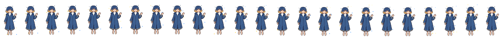

# 派森 重新設計

派森是 Python 的化身，**只有主角看得見**，陪主角從出生走到最後一刻，是導師也是最好的朋友。
說話溫柔、帶點哲理，偶爾俏皮。代表色是 Python 的**藍＋黃**。

新派森放在 `src/actors/npc/paisen.png`（靜止圖或一列動圖都可以），遊戲會優先使用；舊的 `paisen_float_sparkle_sheet.png` 只在沒有新圖時才用。
CG 裡的派森（`ending1`、`ending2`）也要照這份設計畫，見 [CG_PROMPTS.md](CG_PROMPTS.md)。

---

## 舊版的問題



| 問題 | 為什麼要改 |
|---|---|
| **一直在揮手** | 24 格全部都在揮手，難過、說大道理、奶奶過世的場景也在揮，情緒對不上 |
| **光腳站著** | 看起來像普通小孩站在地上，不像「飄著的靈體」。人設寫的是「會發光」，但畫面上沒有光 |
| **跟 Python 的關係看不出來** | 只有髮色是藍黃，沒有其他記憶點 |
| **很小、細節糊** | 每格 212×391，遊戲縮成 0.7 倍，臉幾乎看不清楚 |

---

## 劇情對派森的要求（設計一定要做得到）

| 劇情 | 設計上要能做到 |
|---|---|
| 第一章：新生兒看到的是**一團模糊的光** | 輪廓簡單，模糊之後還認得出是「藍黃的光」 |
| 陪伴一生：主角從嬰兒變成 80 歲老人 | 派森**外表不會老**，跟主角的變化形成對比 |
| 情緒：開心、說道理、擔心、難過、晚年 | 遊戲會用程式調亮度、速度、彈跳。**圖本身只要一個平靜、溫和的表情**，不要誇張的表情 |
| 結局一：派森**化成光點**，融進主角胸口 | 身體下半部本來就是光點，「化成光」才自然 |
| 結局二：主角**第一次擁抱**派森 | 要有人的形體，抱得到（不能只是一顆球或一條蛇） |
| 晚年：派森越來越透明（`@orb fade`） | 半透明時也好看：有亮的輪廓和光暈 |

---

## 三個方向（✅ 已決定：A）

### A. 光之精靈（✅ 採用）

保留人形和舊版的藍髮黃尾，但改成**沒有腳、飄在空中的靈體**。長袍下襬漸漸散成藍黃光點，整個身體邊緣有柔和的光。

- 結局「化成光點」、「擁抱」都畫得出來
- 跟舊版有延續感，CG 和立繪的畫法不用重想
- **Python 記憶點**：胸前的扣子／領口別針是**兩個圓角方塊互扣**（藍上黃下，呼應 Python 標誌的兩條蛇），兩個袖口一藍一黃
- 外表大約 10～12 歲，中性、不分男女

### B. 光之小蛇

藍黃兩色的可愛小蛇精靈，直接對應 Python 這個名字。

- 記憶點最強，很可愛
- 缺點：結局二「擁抱」很難畫，嬰兒視角的「模糊的光」也比較不像

### C. 有臉的光球

就是人設裡寫的「會發光的藍黃光球」，加上簡單的眼睛。

- 最好做動畫，模糊、透明都很好看
- 缺點：表情很少，陪一輩子的「好朋友」感比較弱，結局二也抱不到

---

## A 方案的生圖步驟（PixelLab）

### 步驟 1：先生一張「設定圖」（靜止、正面）

先把長相定下來。滿意之後**記下 seed**，後面每一步都拿這張當參考圖。

- 尺寸：**128×192**（Tier 1 以上可以 **160×240**）
- Remove background：**打開**
- Camera view：`side`；Outline：`selective outline`

```
A gentle androgynous spirit child about 11 years old, floating in the air with no feet,
a long deep-blue hooded robe whose lower hem dissolves into small glowing blue and yellow
light particles, short blue hair with the tips fading into warm yellow, soft glowing
outline around the whole body, calm kind smile, half-closed gentle eyes,
a small clasp on the chest made of two interlocking rounded squares (blue on top,
yellow on bottom), one sleeve cuff blue and the other yellow, hands relaxed at the sides,
front view, pixel art, transparent background, no text.
```

### 步驟 2：做成動圖（飄浮待機）

用 PixelLab 的 **Animate／Animate with text**，以步驟 1 那張當參考。

```
idle floating loop: the spirit gently bobs up and down, robe hem and hair sway softly,
light particles drift upward from the hem, blinks once, calm expression, no waving,
seamless loop
```

**不要揮手**：揮手只適合打招呼的那一刻，一直揮會跟難過的場景衝突。

### 步驟 3：輸出成遊戲要的格式

| 規格 | 要求 |
|---|---|
| 排法 | **一列**，從左到右，每格一樣寬，格子之間不要有間隔 |
| 格數 | 24 格最好（跟現在一樣，什麼都不用改）。不是 24 格也可以，**跟我說幾格**，我改程式的 `SHEET_FRAMES` |
| 速度 | 每秒 12 格，24 格就是 2 秒一個循環 |
| 背景 | **真的透明**（不要是畫上去的灰白格子） |
| 頭尾 | 第 24 格要能接回第 1 格，不要跳一下 |
| 光點 | 可以畫在圖裡；遊戲也會自己再撒一些藍黃光點 |

PixelLab 的動畫通常一次只出 4～8 格。可以：

1. 生 8 格的循環，**重複排 3 次**變成 24 格；或
2. 直接給我那 8 格，我把程式改成 8 格、每秒 6～8 格。

> 如果你要的話，可以把每一格存成 `paisen_01.png`、`paisen_02.png`……丟進同一個資料夾，我幫你拼成一列。

### （可選）步驟 4：揮手版

第一章第一次見面、跟玩家打招呼的時候用。做好之後放 `paisen_wave_sheet.png`，我再把程式接上。

```
the spirit raises one hand and waves hello once, warm smile, then lowers the hand,
seamless loop back to idle pose
```

---

## 設計決定之後要一起改的地方

- [x] 新派森靜止圖：`src/actors/npc/paisen.png`（2026-11-15，使用者的 `py.png` 去背後放入；遊戲優先用它，飄浮和光點由程式做）
- [ ] （之後）新派森做成動圖：一列 N 格存成 `paisen.png`，把 `pyson_orb.gd` 的 `STILL_FRAMES` 改成 N
- [ ] [CG_PROMPTS.md](CG_PROMPTS.md) 的 `ending1`、`ending2`：派森的描述改成新設計（拿步驟 1 的設定圖當參考）
- [x] `src/game/stage/game_stage.gd` 的 `PERSONAS["派森"]`：已改成「藍黃光芒組成的小精靈」（2026-11-15）
- [x] 尺寸：程式會自動把任何高度的圖換算成原本的顯示大小，不用改
